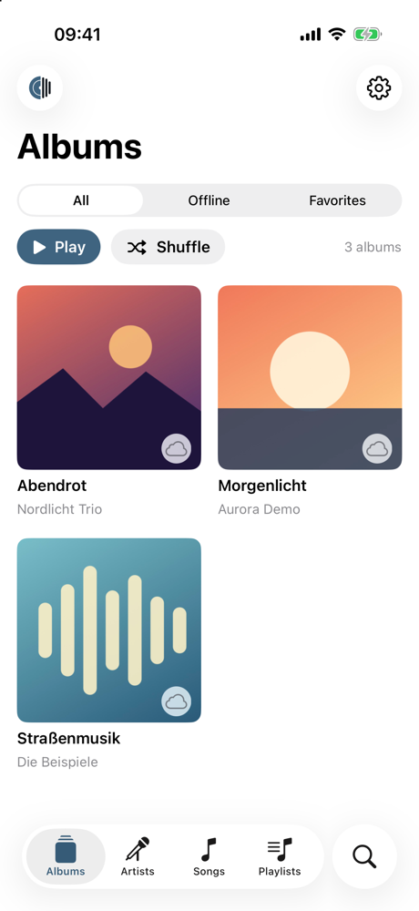
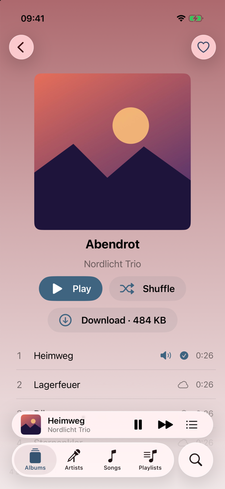
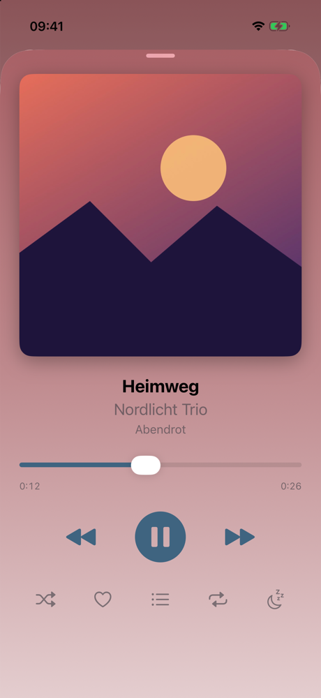

# NAS Player

**Your music. From your NAS.**

NAS Player is an iPhone app that plays your own music collection (MP3 and M4A) from a Synology NAS running Audio Station. Stream your whole library, download the albums and artists you want for offline listening, and keep listening when you have no network. It also works with CarPlay and Siri.

  
  
  

*Screenshots show demo mode with sample music, no NAS needed.*

**[Download NAS Player on the App Store](https://apps.apple.com/app/id6821177203)** (listed there as "NAS Music Player", free, no in-app purchases)

## Highlights

- Browse and stream your whole library without downloading everything
- Download albums, artists or songs to the iPhone for offline listening, with a storage limit
- Favorites, your own playlists, shuffle and repeat, sleep timer, statistics and a year in review
- CarPlay and Siri support
- Available in English, German, Czech, Spanish, Italian and French
- No ads, no tracking, no accounts. Everything stays on your iPhone.

See the [release notes](https://brandocz.github.io/nas-player/en/releases.html) for what each version brought and [what is coming next](https://brandocz.github.io/nas-player/en/upcoming.html).

## Feedback and support

This repository contains **no app source code**. It is used for:

- **Feedback and bug reports:** via [Issues](../../issues) (templates for bugs and feature requests)
- **Support, privacy policy and legal notice:** on the [app's website](https://brandocz.github.io/nas-player/en/support.html) (GitHub Pages)

Please do **not** post credentials, your NAS address or personal data in issues. Issues are public.

*NAS Player is not affiliated with Synology. Synology and Audio Station are trademarks of Synology Inc. Apple, iPhone, CarPlay and App Store are trademarks of Apple Inc.*
